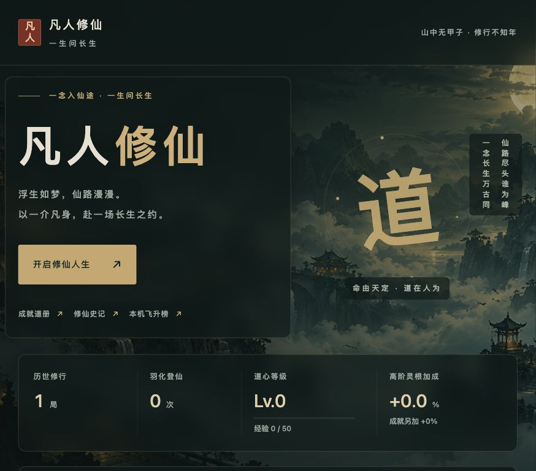
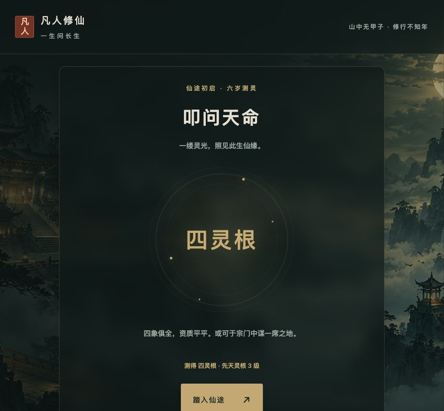
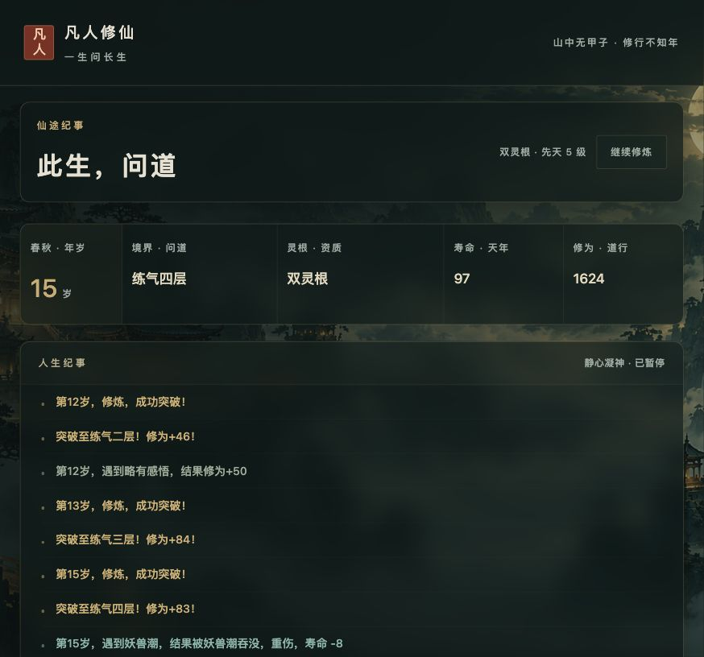

<div align="center">

# 凡人修仙 · 一生问长生

**六岁测灵根，一生赌仙缘。下一世，能不能轮到我飞升？**

一款国风文字修仙模拟器。抽灵根、遇机缘、破境界，看一介凡人的命运在岁月里展开。

**十档灵根 · 十境百层 · 21 种随机事件 · 20 项成就**

[看看怎么玩](#怎么玩) · [本地开玩](#本地开玩) · [部署自己的版本](#部署自己的版本)

喜欢这种「再来一世」的快乐，欢迎点亮右上角的 **Star ⭐**，给仙途添一份机缘。



</div>

## 这一世，你会走到哪一步？

开局一测，四灵根。资质平平，仙途未卜。

你可能困在某个境界，眼看寿元将尽；也可能偶得仙草、灵根异变，一场机缘改写此生。等到渡劫之时，是羽化登仙，还是来生再问长生？

这里的乐趣，是看命运一点点揭晓：**抽到好灵根想看看能走多远，抽到差灵根又想赌一次逆天改命。**

| 仙途看点 | 你会遇见什么 |
| --- | --- |
| 🎲 六岁测灵 | 从伪灵根到仙体，十档先天资质，每一世都有新的起点 |
| ⛰️ 十境百层 | 从炼体一路向渡劫，突破带来更高境界与更长寿元 |
| 📜 随机机缘 | 21 种事件，仙草、秘境、灵根异变……机遇与凶险都可能找上门 |
| ✨ 飞升之路 | 冲击成仙劫、寻找仙人信物，还有极稀有的仙帝传承 |
| 🔁 再入轮回 | 结算积累道心经验，解锁 20 项成就，为下一世增加高阶灵根的机会 |
| 🍵 轻松看人生 | 自动推进修炼，可暂停、调整纪事速度、手动存档，再回顾这一生 |

## 游戏实景

以下截图均来自实际运行界面。

### 叩问天命 · 先看看自己的仙缘



### 此生问道 · 让岁月写下修仙故事



## 怎么玩

1. 点击 **开启修仙人生**，在六岁测出先天灵根。
2. 点击 **踏入仙途**，观看修炼、突破与随机事件自动发生。
3. 想细看纪事就暂停，想下次继续就手动存档。
4. 人生结束后回顾经历、领取经验，再入轮回；飞升后还可在本机飞升榜留下道号。

这是随机人生模拟，修炼与事件自动结算。慢速 / 正常控制纪事展示间隔，无事发生的年份会自动跳过。

**电脑和手机都能玩，无需注册。** 存档、成就、历史和排行榜保存在当前浏览器；清除网站数据会丢失记录，不同设备或域名之间不会自动同步。

## 本地开玩

需要 Node.js 20.19+ 或 22.12+。

```bash
npm install
npm run dev
```

打开终端打印的本地地址，即可开启第一世修仙人生。无需后端，也不需要 API Key。

其他命令：

```bash
npm test       # 核心规则与原版逐年对照测试
npm run build  # TypeScript 检查及生产构建
npm run preview
```

## 部署自己的版本

项目是纯静态网页，可部署到静态网站托管服务，或通过宝塔部署到自己的服务器。

1. 执行 `npm run build`。
2. 将 `dist/` **里面的所有文件和文件夹**上传到网站根目录，不要额外套一层 `dist`。
3. 确认网站根目录指向上传位置。

背景图与图标也需要一起上传，构建后的目录大致如下：

```text
dist/
├── index.html
├── seal.svg
├── apple-touch-icon.png
├── assets/
│   ├── index-<hash>.js
│   └── index-<hash>.css
└── backgrounds/
    ├── landscape-desktop.png
    └── landscape-mobile.png
```

<details>
<summary>可选：配置链接分享封面</summary>

`index.html` 已包含 Open Graph 和 Twitter 的标题、简介及图片说明。仓库不预设站点域名；部署后如需分享封面，请自行添加 `og:url`、`og:image`、`twitter:image` 标签，使用你自己的完整 HTTPS 页面地址和公开图片地址。

默认封面素材为 `public/backgrounds/landscape-desktop.png`。更换图片时，同步更新图片类型、宽高和图片说明；重新构建并上传 `dist/` 的全部内容。社交平台可能缓存旧封面，更换图片建议使用新文件名。

</details>

## 想研究一下仙缘？

使用 **Vite + TypeScript + CSS**，模拟核心为独立 JavaScript 模块，界面与模拟逻辑分离。

- [核心算法文档](docs/ALGORITHMS.md)：灵根概率、突破公式、随机事件、飞升条件与存档格式。
- [验证记录](docs/VERIFICATION.md)：核心对照测试与浏览器验证范围。
- `src/core/`：数据表、事件与模拟器。
- `src/main.ts` / `src/style.css`：界面交互与国风样式。

欢迎通过 Issue 反馈问题、分享有趣的修仙经历，也欢迎提交 PR。

**愿道友下一世，灵根上佳，仙途坦荡。⭐ 喜欢就 Star，留待下次再入轮回。**
